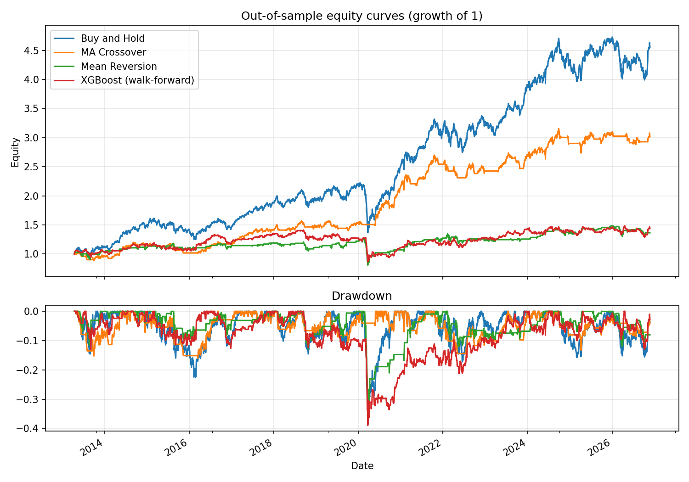

# Nifty 50 Quantitative Backtesting: Feature Engineering and ML Signals

Walk-forward backtest of rule-based and machine-learning trading signals on Nifty 50 daily data, evaluated net of transaction costs with risk-adjusted metrics.

> **Status:** Pipeline complete. Run it to regenerate the results table below.

## Problem

Can simple technical signals and a gradient-boosted model produce a risk-adjusted edge over buy-and-hold on Indian equity data, once transaction costs and look-ahead bias are controlled?

## Data

- Source: Yahoo Finance via `yfinance`, Nifty 50 index (`^NSEI`)
- Frequency: daily OHLCV, from 2010-01-01
- Evaluation: strictly out-of-sample (see walk-forward below)

## Approach

1. **Features** (all computed from data up to day *t*): SMA(10/50) ratio, RSI(14), 20-day Z-score, 20-day volatility, 5- and 20-day momentum, daily return
2. **Strategies** (long/flat)
   - *MA Crossover*: long when SMA10 > SMA50
   - *Mean Reversion*: enter long at Z < -1, exit at Z >= 0
   - *XGBoost*: predicts next-day direction, long if P(up) > 0.5
3. **Walk-forward validation**: expanding window, model retrained every 252 trading days on past data only, first model after 3 years of history
4. **No look-ahead**: signal at close of day *t* is traded at close of day *t+1*
5. **Costs**: 5 bps charged on every position change
6. **Metrics**: annualised return and volatility, Sharpe (risk-free = 0), max drawdown, win rate, round trips. All strategies and buy-and-hold are compared over the same out-of-sample window

## Results

Run the notebook or the script, then paste `results/metrics.csv` here.

| Strategy | Ann. Return | Sharpe | Max Drawdown |
|---|---|---|---|
| Buy and Hold | 0.121 | 0.788 | -0.384 |
| MA Crossover | 0.087 | 0.838 | -0.161 |
| Mean Reversion | 0.024 | 0.257 | -0.357 |
| XGBoost (walk-forward) | 0.028 | 0.280 | -0.389 |



## Repository Structure

```
.
├── notebooks/nifty50_backtest.ipynb   # full walkthrough with plots
├── src/nifty_backtest.py              # features, signals, backtest, metrics (also a CLI)
├── results/                           # metrics.csv and equity_curves.png (generated)
├── requirements.txt
└── README.md
```

## How to Run

```bash
git clone <repo-url>
cd nifty50-quant-backtesting
pip install -r requirements.txt

# option 1: notebook
jupyter notebook notebooks/nifty50_backtest.ipynb

# option 2: command line
python src/nifty_backtest.py --start 2010-01-01 --cost-bps 5
```

## Limitations

Single index, daily bars, flat cost model with no slippage or taxes, one fixed set of XGBoost hyperparameters. Past performance does not imply future results.

## Planned Extensions

- Constituent-level portfolio construction across Nifty 50 stocks
- Hyperparameter search inside the walk-forward loop
- Multi-agent LLM signal layer (LangGraph)

## Author

Chinmaya Teja Vasala, B.Tech CSE, Vasavi College of Engineering
